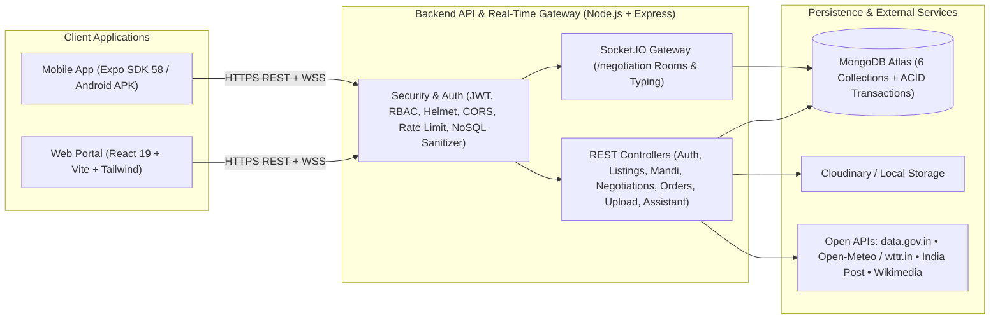

<div align="center">

# 🌾 CropGuard Market

### Direct Farmer-to-Buyer Agricultural Exchange • Live APMC Mandi Intelligence • 8-Language AI Assistant

[](https://cropguard-market.vercel.app/)
[](https://expo.dev/accounts/itsriteshxs/projects/cropguard-market-app/builds/52710454-a2f1-4b79-8285-8b33954dd0cd)
[](https://cropguard-market.onrender.com/api/health)

[](https://nodejs.org/)
[](https://expressjs.com/)
[](https://react.dev/)
[](https://expo.dev/)
[](https://www.mongodb.com/)
[](https://socket.io/)
[](https://tailwindcss.com/)

[Live Links](#-live-deployments) • [Architecture](#-system-architecture) • [Features](#-core-features) • [External APIs](#-live-open-apis--data-pipeline) • [Quick Start](#-local-development-setup) • [Tests](#-automated-verification-suite)

</div>

---

## 🌐 Live Deployments

| Surface | Stack | Hosting | Status | Access |
|:---|:---|:---|:---|:---|
| **Web Portal** | React 19 + Vite + Tailwind + Recharts | Vercel | `Online` | [cropguard-market.vercel.app](https://cropguard-market.vercel.app/) |
| **Android Mobile App** | React Native + Expo SDK 58 | Expo EAS (`.apk`) | `Ready` | [Download & Install APK](https://expo.dev/accounts/itsriteshxs/projects/cropguard-market-app/builds/52710454-a2f1-4b79-8285-8b33954dd0cd) |
| **API & Socket Gateway** | Node.js + Express + Socket.IO + MongoDB Atlas | Render | `Connected` | [Health Check (`/api/health`)](https://cropguard-market.onrender.com/api/health) |

---

## 📌 Problem Statement & Solution

* **Problem Statement:** Mobile App for Direct Market Access for Farmers
* **Domain:** AgriTech, Rural Supply Chain & Distributed Commerce
* **Academic Context:** Inspired by **Ministry of Agriculture & Farmers Welfare**, **UASD Dharwad**, and **ICAR** guidelines
* **Repository:** [github.com/itsriteshx/Cropguard-market](https://github.com/itsriteshx/Cropguard-market)

### Why CropGuard Market?
Traditional agricultural mandi chains force farmers through multiple commission agents (*arhatiyas*), reducing farmer realizations while leaving producers blind to real-time APMC modal rates. **CropGuard Market** connects verified farmers directly with retail and wholesale buyers across **Web** and **Mobile** with:
1. Live **Agmarknet** modal/min/max rate benchmarks before accepting any offer.
2. **Real-time WebSocket bargaining** with turn-based counter-offers, live chat, and typing indicators.
3. **MongoDB ACID transaction-backed** order placement, inventory reservation, and a Digital Khata ledger.
4. **8-Language localization & AI Assistant** for accessible regional onboarding.

---

## 🔄 How It Works — 5 Core Platform Workflows

1. **Farmers List Produce (`Sell Produce`):**  
   Farmers sign in and publish harvests with crop name, quantity (`KG`/`QUINTAL`), quality grade, produce photos, asking price, and an **India Post Pincode-verified** farm location. Farmers can manage active lots via **"My Active Listings"** with real-time editing and safe deletion protected by backend referential integrity.
2. **Buyers Discover & Compare (`Wholesale Marketplace`):**  
   Buyers browse active farmer lots, compare asking rates against **Government APMC modal benchmarks**, and check proximity (**Haversine distance in `km`**). If a searched crop (such as *Apple* or *Garlic*) has no local farmer listing, live **Agmarknet crop photo + mandi rate cards** appear automatically below.
3. **Live Bargaining (`Negotiations via Socket.IO`):**  
   Buyers tap **Make Offer** → Farmer and Buyer negotiate turn-by-turn inside an authenticated real-time **Socket.IO** room with counter-offers, live chat messages, typing indicators, and final **Accept / Reject** actions.
4. **Order Booking, Stock Reservation & Ledger (`Bulk Orders & Digital Khata`):**  
   On deal acceptance, placing an order atomically reserves crop inventory inside a **MongoDB transaction**, tracks order stages (`PLACED` → `ESCROW_HELD` → `DISPATCHED` → `DELIVERED` → `SETTLED`), restores stock on cancellation, and generates a **Digital Khata** entry and demo-simulated settlement receipt.
5. **Pan-India Live Mandi Rates & Weather (`APMC Mandi Intelligence`):**  
   Pulls live **Agmarknet (`data.gov.in`)** data (*State, District, APMC Market, Commodity, Variety, Grade, Arrival Date, Min/Modal/Max Price*), illustrative **Wikipedia REST** crop photos (served via backend proxy), **Open-Meteo / `wttr.in`** district weather advisories, **Best Mandi Comparison**, **CSV Export**, and an **Illustrative Price Threshold Simulator**.

---

## ✨ Core Features

<table>
<tr>
<td width="50%" valign="top">

### 🌾 Marketplace & Produce Publishing
* **Farmer Lot Publishing:** Unit conversion (`KG` / `QUINTAL`), quality grading (`GRADE_A`, `GRADE_B`, `ORGANIC`), live crop suggestions, and Agmarknet modal guidance.
* **Farmer Inventory Management:** Web & Mobile "My Active Listings" with real-time editing modal (price, quantity, grade, status), two-step deletion confirmation, and backend referential integrity protection (prevents deleting lots with active negotiations or orders).
* **India Post Pincode Auto-Fill:** 6-digit pincodes resolve District, Taluk, and State automatically via India Post API.
* **Smart Image Pipeline:** Client-side HEIC/image compression (`expo-image-manipulator`), Multer validation, Cloudinary / local `/uploads` storage, and a cached backend Wikimedia thumbnail proxy (`/api/mandi-rates/image`).

### 🤝 Real-Time Negotiation & Chat
* **Socket.IO `/negotiation` Namespace:** Authenticated rooms (`user_<id>`, `room_<negotiationId>`) broadcast instant updates while REST APIs enforce validated writes.
* **Turn-Based Bidding & Free-Text Chat:** Counter-offers, live typing status (`typing_start` / `typing_stop`), individual chat message deletion, and closed-deal cleanup.

</td>
<td width="50%" valign="top">

### 📊 APMC Mandi Intelligence & Analytics
* **Live Market Explorer:** Filter across Indian states and commodities (`data.gov.in` Agmarknet feed) with MongoDB snapshot caching across 900+ saved market records.
* **Web Oversight Charts:** Interactive price trend line charts, market spread comparisons, and simulated fairness threshold evaluation (`Recharts`).
* **District Weather & Transit Advisory:** Live temperature, daily High/Low, humidity, wind speed, and harvest/transit advisories via **Open-Meteo** with automatic **`wttr.in`** fallback.

### 📦 Orders, Khata Ledger & AI Assistant
* **Transactional Order Engine:** Reserves produce stock atomically inside `mongoose.startSession()` transactions (`PLACED` → `ESCROW_HELD` → `DISPATCHED` → `DELIVERED` → `SETTLED`), restoring stock on cancellation.
* **Digital Khata & Receipts:** Farmer revenue tracking powered by high-performance **MongoDB Aggregation Pipelines** (`$match`, `$project`, `$group`), compound indexes, estimated middleman-margin savings, and printable demo receipts *(payment states are simulated for demonstration)*.
* **8-Language AI Assistant:** Natural-language price lookups, weather checks, screen navigation, and midpoint counter-offer guidance with **Web Speech API** (Web) and **`expo-speech` Read-Aloud** (Mobile).

</td>
</tr>
</table>

### Supported Indian Languages (`8`)

| Code | Language | Code | Language |
|:---|:---|:---|:---|
| `en` | 🌐 English (Pan-India) | `te` | 🌶️ తెలుగు (AP & Telangana) |
| `hi` | 🇮🇳 हिन्दी (North / Central) | `ta` | 🥥 தமிழ் (Tamil Nadu) |
| `kn` | 🌾 ಕನ್ನಡ (Karnataka / UASD) | `gu` | 🥜 ગુજરાતી (Gujarat APMC) |
| `mr` | 🚜 मराठी (Maharashtra APMC) | `pa` | 🌾 ਪੰਜਾਬੀ (Punjab Mandis) |

---

## 🏛 System Architecture



---

## 🔌 Live Open APIs & Data Pipeline

| Service | Usage in CropGuard | Caching & Reliability |
|:---|:---|:---|
| **Agmarknet (`data.gov.in`)** | Live daily modal/min/max mandi prices | In-memory TTL cache, in-flight deduplication & MongoDB snapshot fallback |
| **Open-Meteo + `wttr.in`** | District temperature, High/Low, humidity & harvest advisory | Static Indian APMC coordinate fallback + automatic `wttr.in` failover on HTTP 429 |
| **India Post Pincode API** | 6-digit postal code → District / Taluk / State autofill | 24-hour geocode cache |
| **Wikipedia REST + Proxy** | Illustrative crop imagery (`/api/mandi-rates/image`) | SSRF-allowlisted host check + 24-hour buffer cache for mobile & cross-origin web |
| **Mandi CSV ETL Pipeline** | `backend/scripts/mandiETL/` (`extract → transform → load`) | Strict schema/unit/date normalization & bulk upsert with rejection reporting |

<details>
<summary><strong>📡 Mounted REST API Route Groups (11 Modules)</strong></summary>

| Base Path | Responsibility | Auth |
|:---|:---|:---|
| `/api/health` | Service & MongoDB connection probe | Public |
| `/api/auth` | Register, login, profile (`/me`), language sync | Public / JWT |
| `/api/listings` | Produce CRUD, filters, geo-radius & benchmark enrichment | Public / Farmer JWT |
| `/api/mandi-rates` | Saved rates, `/live`, `/weather`, `/pincode/:pin`, `/image`, `/benchmark`, `/analytics` | Public |
| `/api/negotiations` | Offers, counters, accept/reject, chat send/delete, closed deal delete | JWT (Participant) |
| `/api/orders` | Transactional orders, state transitions, `/farmer-ledger`, `/:id/receipt` | JWT (Participant / Admin) |
| `/api/upload` | Multi-photo produce upload (`multer` 5MB/5 files) | JWT (Farmer / Admin) |
| `/api/assistant` | Multilingual AI query parser (`POST /query`) | JWT |
| `/api/audit` | Fair-trade summary & compliance logs | Public / Admin |
| `/api/languages` | Supported 8-language catalog | Public |
| `/api/docs` | API endpoint catalog for Admin Health dashboard | Public |

</details>

---

## 📂 Repository Structure

```text
cropguard-market/
├── backend/
│   ├── scripts/mandiETL/       # Agmarknet CSV Extract-Transform-Load & duplicate checks
│   ├── src/
│   │   ├── config/             # MongoDB, Cloudinary, CORS & JWT production enforcement
│   │   ├── controllers/        # Auth, Listing, Mandi, Negotiation, Order, Upload, Audit, Assistant
│   │   ├── i18n/               # Backend locale metadata (8 languages)
│   │   ├── middleware/         # Auth/RBAC, Rate limiters, NoSQL sanitizer, Multer, Error handler
│   │   ├── models/             # User, ProduceListing, Negotiation, Order, MandiRate, AuditLog
│   │   ├── routes/             # 11 modular Express routers
│   │   ├── services/           # Agmarknet, Open-Meteo/wttr.in, India Post, Wikipedia integrations
│   │   ├── sockets/            # Authenticated Socket.IO /negotiation rooms & typing
│   │   └── utils/              # JWT generator & DB health check
│   ├── test/                   # Backend unit, security, socket & assistant tests
│   └── .env.example
│
├── frontend/
│   ├── mobile/                 # Expo React Native App (Android APK & iOS/Android Expo Go)
│   │   ├── src/
│   │   │   ├── auth/           # Session manager & language sync
│   │   │   ├── components/     # AssistantModal (TTS), CropImage (proxy + fallback)
│   │   │   ├── config/         # API origin resolver & unauthorized session handler
│   │   │   ├── context/        # AuthContext & SocketContext
│   │   │   ├── i18n/           # 8-language mobile dictionary
│   │   │   ├── screens/        # Auth, Marketplace, MandiRates, Sell, Negotiations, Orders, Ledger, Profile
│   │   │   ├── services/       # Socket.IO client singleton
│   │   │   └── utils/          # Photo prep, price unit converter, location validator, typing controller
│   │   ├── test/               # Mobile client & helper tests
│   │   ├── app.json
│   │   └── eas.json
│   │
│   └── web/                    # React 19 + Vite Wholesale & Admin Web App (Vercel)
│       ├── src/
│       │   ├── components/     # Navbar, Sidebar, VoiceAssistantWidget, ReceiptInvoiceModal
│       │   ├── context/        # AuthContext & 8-language provider
│       │   ├── i18n/           # Web multilingual translations
│       │   ├── pages/          # Login, Marketplace, Sell, Negotiations, MandiAnalytics, Orders, Compliance, SystemHealth
│       │   └── services/       # Axios API client & Socket.IO connector
│       └── vite.config.js
│
└── database/
    ├── ER_DIAGRAM.md           # 6-collection Mermaid ER diagram
    └── README.md               # Schema & indexing guide
```

---

## 🔧 Local Development Setup

### Prerequisites
* **Node.js** `v20+` & **npm** `v9+`
* **MongoDB Atlas** URI (or local MongoDB replica set — required for order transactions)
* **Expo Go** on Android/iOS (or download the prebuilt Android `.apk` above)

### 1. Clone & Configure Backend
```bash
git clone https://github.com/itsriteshx/Cropguard-market.git
cd Cropguard-market
npm install
cp backend/.env.example backend/.env
```
Update `backend/.env` with your `MONGO_URI` and a strong `JWT_SECRET` (32+ chars in production; optional `CLOUDINARY_*` keys for cloud image storage). Then start the API server:

```bash
npm run backend
# Verify at http://localhost:5001/api/health
```

### 2. Run Web Portal
```bash
npm run web
# Opens Vite dev server at http://localhost:3000 with proxy to :5001
```

### 3. Run Mobile App (Expo Go)
```bash
cp frontend/mobile/.env.example frontend/mobile/.env
# Set EXPO_PUBLIC_API_ORIGIN to your Render URL or http://<YOUR_LAN_IP>:5001
cd frontend/mobile
npx expo start
```

---

## 🧪 Automated Verification Suite

All tests run via Node's built-in test runner with zero external test framework overhead:

```bash
# Backend unit, security, socket & assistant tests (84 tests)
npm --prefix backend test

# Mandi ETL CSV transformation & validation tests (24 tests)
node backend/scripts/mandiETL/testTransform.js

# Mobile API client, auth, photo prep, typing & location tests (43 tests)
node --test frontend/mobile/test/*.test.cjs

# Web production bundle verification
npm --prefix frontend/web run build
```
