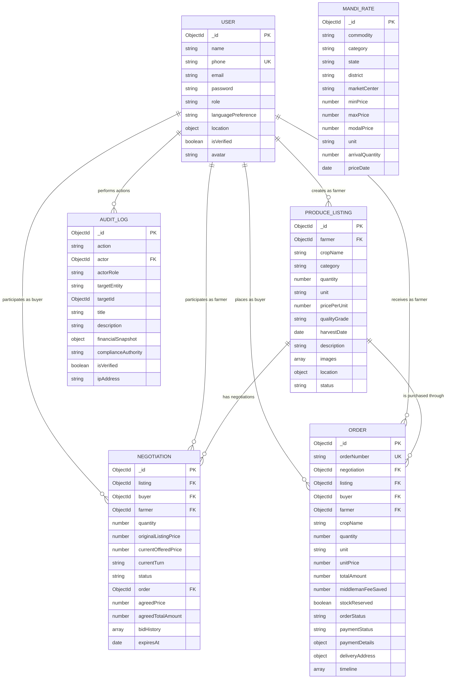

# CropGuard Market — Entity Relationship Diagram

## 1. Overview

CropGuard Market uses MongoDB with Mongoose for data storage.

The database contains six main collections:

- User
- ProduceListing
- Negotiation
- Order
- MandiRate
- AuditLog

The relationships shown below represent logical references between MongoDB documents. Unlike a relational SQL database, MongoDB does not automatically enforce foreign-key constraints.

## 2. ER Diagram

## 3. Relationship Explanation

| Relationship | Cardinality | Explanation |
|---|---|---|
| User → ProduceListing | One-to-many | A farmer can create multiple listings. |
| User → Negotiation (buyer) | One-to-many | A buyer can participate in multiple negotiations. |
| User → Negotiation (farmer) | One-to-many | A farmer can receive multiple negotiations. |
| ProduceListing → Negotiation | One-to-many | A listing can have multiple negotiations. |
| User → Order (buyer) | One-to-many | A buyer can place multiple orders. |
| User → Order (farmer) | One-to-many | A farmer can receive multiple orders. |
| ProduceListing → Order | One-to-many | A listing can be associated with multiple orders. |
| User → AuditLog | One-to-many | A user can generate multiple audit logs. |

## 4. Important Database Design Notes

### Embedded documents

- `Negotiation.bidHistory` stores offers and counteroffers.
- `Order.timeline` stores order status updates.

These are embedded subdocuments, not separate collections.

### Negotiation and Order

Both models contain optional references to each other:

- `Negotiation.order`
- `Order.negotiation`

These references do not establish a database-enforced one-to-one relationship.

### AuditLog polymorphic reference

`AuditLog.targetId` identifies the affected document. `targetEntity` indicates its collection.

This is a polymorphic reference, not a conventional foreign key.

### MandiRate

`MandiRate` stores market-price information independently and has no direct reference to the other five collections.

## 5. Database Technology

| Property | Implementation |
|---|---|
| Database | MongoDB |
| ODM | Mongoose |
| Data model | Document-oriented |
| Primary identifier | ObjectId (`_id`) |
| Relationships | Mongoose references |
| Embedded data | Bid history and order timeline |
| Geospatial support | GeoJSON and 2dsphere indexes |